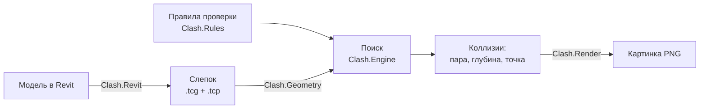

<h1 align="center">ToadClash</h1>

<p align="center">
  Поиск коллизий между моделями Revit без Navisworks.<br>
  Библиотеки .NET, Revit 2020–2027.
</p>

<p align="center">
  <a href="https://www.nuget.org/packages/Alexpivo394.Revit.Clash.Engine"></a>
  <a href="https://github.com/Alexpivo394/ToadClash/actions/workflows/Build.yml"></a>
  <a href="License.md"></a>
</p>

---

ToadClash — ядро поиска коллизий сервиса [ToadFlow](https://github.com/Alexpivo394/ToadFlow) и панели «Коллизии» в [ToadTools](https://github.com/Alexpivo394/ToadTools). Интерфейса у него нет: это пять пакетов NuGet, из которых собирается свой конвейер.

Revit нужен только на первом шаге — снять с модели слепок. Поиск и картинки работают уже без Revit и без Navisworks, на .NET 8.



Что считается коллизией:

- пересечение сеток двух элементов или вложение одной сетки в другую глубиной больше допуска;
- допуск задаётся клеткой матрицы проверок: по умолчанию 20 мм, наименьший — 0,05 мм;
- элемент сам с собой, соединённые элементы MEP и вложенные семейства одного изделия друг с другом не проверяются.

Все размеры — в миллиметрах.

## Пакеты

| Пакет | Платформы | Revit API | Назначение |
|---|---|---|---|
| [`Alexpivo394.Revit.Clash.Revit`](https://www.nuget.org/packages/Alexpivo394.Revit.Clash.Revit) | по году Revit | да | Выгрузка геометрии и параметров 3D-вида в слепок |
| [`Alexpivo394.Revit.Clash.Geometry`](https://www.nuget.org/packages/Alexpivo394.Revit.Clash.Geometry) | `net47`, `net8.0` | нет | Слепок модели: файлы `.tcg` (сетки) и `.tcp` (параметры) |
| [`Alexpivo394.Revit.Clash.Rules`](https://www.nuget.org/packages/Alexpivo394.Revit.Clash.Rules) | `net48`, `net8.0` | нет | Группы, наборы выбора, матрица проверок, исключения |
| [`Alexpivo394.Revit.Clash.Engine`](https://www.nuget.org/packages/Alexpivo394.Revit.Clash.Engine) | `net8.0` | нет | Поиск коллизий, повторный прогон по основе прошлого, сопоставление пересозданных элементов |
| [`Alexpivo394.Revit.Clash.Render`](https://www.nuget.org/packages/Alexpivo394.Revit.Clash.Render) | `net8.0` | нет | Картинка коллизии в PNG без видеокарты |

Пакеты ядра выходят вместе под одной версией. Версия пакета выгрузки — год Revit, затем major и minor ядра: ядру `1.3.0` соответствует `2027.1.3` для Revit 2027. Исправление выгрузки выходит с новой minor-версией ядра.

## Три шага

### 1. Слепок модели

```xml
<PackageReference Include="Alexpivo394.Revit.Clash.Revit" Version="[$(RevitVersion).1.3]"/>
```

Выгрузка работает в контексте Revit API и берёт элементы, видимые на заданном 3D-виде:

```csharp
var result = GeometryExtractor.Extract(document, new ExtractOptions(ModelKey: "ar-1", ViewName: "Navisworks"), ct);

using (var tcg = File.Create("model.tcg")) ModelGeometryFile.Write(tcg, result.Geometry);
using (var tcp = File.Create("model.tcp")) ModelParametersFile.Write(tcp, result.Parameters);
```

Элемент, на котором Revit выдал ошибку, в слепок не попадает и перечислен в `result.Skipped`; выгрузка остальных продолжается. Если 3D-вида с таким именем нет, `Extract` выбрасывает `ArgumentException` с `ParamName == "viewName"`.

### 2. Поиск

```xml
<PackageReference Include="Alexpivo394.Revit.Clash.Engine" Version="1.*"/>
```

```csharp
ModelInput Load(string discipline, string folder)
{
    using var tcg = File.OpenRead(Path.Combine(folder, "model.tcg"));
    using var tcp = File.OpenRead(Path.Combine(folder, "model.tcp"));
    return new ModelInput(discipline, ModelGeometryFile.Read(tcg), ModelParametersFile.Read(tcp));
}

var config = ConfigurationJson.Deserialize(File.ReadAllText("config.json"));
var models = new[] { Load("АР", @"snapshots\ar"), Load("ОВ", @"snapshots\ov") };

var result = new ClashEngine(new EngineOptions()).Run(models, config, ct);
foreach (var hit in result.Hits)
    Console.WriteLine($"{hit.A.UniqueId} × {hit.B.UniqueId}: {hit.DepthMm:0.#} мм");
```

- Результат не зависит от порядка моделей и числа потоков. `EngineOptions.MaxDegreeOfParallelism` ограничивает потоки; 0 — все ядра.
- Параметр `previous` метода `Run` принимает основу прошлого прогона той же конфигурации: пары неизменных элементов берутся из неё без повторной проверки.
- Основа с другим `ClashEngine.AlgorithmVersion` не годится. Это проверяет вызывающий.

### 3. Картинка

```xml
<PackageReference Include="Alexpivo394.Revit.Clash.Render" Version="1.*"/>
```

`CollisionScenes.Build` собирает сцену по оглавлениям слепков: оба элемента коллизии и окружение в секущем кубе вокруг зоны пересечения. `CollisionRenderer.Render` рисует её и возвращает PNG: первый элемент красный, второй синий, окружение серое и полупрозрачное.

```csharp
SceneModel Open(string path)
{
    using var tcg = File.OpenRead(path);
    return new SceneModel(ModelGeometryFile.ReadIndex(tcg), () => File.OpenRead(path));
}

var scenes = new[] { Open(@"snapshots\ar\model.tcg"), Open(@"snapshots\ov\model.tcg") };
var scene = CollisionScenes.Build(scenes, new SceneTarget(hit.A.ModelKey, hit.A.UniqueId, hit.B.ModelKey, hit.B.UniqueId, hit.PointX, hit.PointY, hit.PointZ));
File.WriteAllBytes("collision.png", CollisionRenderer.Render(scene).Png);
```

## Координаты

Слепок хранит координаты в общей системе координат документа (площадка `ActiveProjectLocation`), как выгрузка NWC по общим координатам. Модели разных разделов совмещаются без пересчёта.

- **Точность.** Вершины записаны во `float` относительно начала слепка `ModelHeader.OriginX/Y/Z`. Начало — внутреннее начало документа в общих координатах, округлённое до метра. От элементов оно не зависит, поэтому отпечатки неизменных элементов совпадают между выгрузками.
- **Далёкие элементы.** Элементы дальше 1 км от внутреннего начала считаются в `ExtractResult.FarElements`: там шаг `float` грубее 0,06 мм.
- **Несовмещённые модели.** Если основная часть модели (габарит 98 % элементов) лежит дальше 10 м от остальных, `Run` выбрасывает `ModelsNotAlignedException` с ключами этих моделей. Отдельные далёкие элементы модель несовмещённой не делают.
- **Точка коллизии** `ClashHit.PointX/Y/Z` — в миллиметрах общей системы координат.

## Сборка и тесты

```powershell
dotnet build ToadClash.slnx
dotnet test --project tests/Alexpivo394.Revit.Clash.Tests
```

Тесты выгрузки идут без Revit и собираются против API нужного года:

```powershell
dotnet test --project tests/ToadClash.Extractor.Tests -p:ExtractorApiYear=2022
```

Пакеты собирает пайплайн `build/` в папку `output/`:

```powershell
cd build
$env:DOTNET_ENVIRONMENT = "Development"; $env:Publish__Version = "1.1.0-dev"; dotnet run -c Release -- pack
```

Каждый push проверяет `Build.yml`: тесты ядра, тесты выгрузки и сборка выгрузки для Revit 2020 и 2027.

### Выпуск версии

Тег `X.Y.Z` запускает `PublishRelease.yml`. Workflow собирает пакеты ядра версии `X.Y.Z` и пакеты выгрузки `{год}.X.Y` для Revit 2020–2027, публикует их на nuget.org через trusted publishing и создаёт релиз на GitHub. Ключа nuget.org в репозитории нет: доверие к репозиторию настроено в профиле `Alexpivo394` на nuget.org.

## Инструменты разработки

`tools/ToadClash.Bench` — замеры и сверки из командной строки:

| Команда | Что делает |
|---|---|
| `synth --elements 200000 --models 12 --seed 1 --profile dense --out <папка>` | Создаёт синтетические слепки |
| `run --in <папка> --threads 8` | Прогоняет `config.json` по всем слепкам папки и печатает время и память |
| `identity --old <tcg> --new <tcg>` | Сопоставляет элементы двух выгрузок одной модели |
| `navis-all --settings <xml> --reports <папка> --snapshots <папка> --out <папка>` | Сверяет все проверки Navisworks с результатом движка |

Разделы реальных моделей для `run` задаёт `model-disciplines.json` в папке слепков: ключ модели из заголовка слепка — раздел.

`tools/ToadClash.DevAddin` — аддин Revit 2022 с кнопками выгрузки текущей модели и генерации синтетических моделей. Без установки в Revit он собирается так:

```powershell
dotnet build tools/ToadClash.DevAddin -c Release.R22 -p:DeployAddin=false
```

## Соседние проекты

| Проект | Зачем он |
|---|---|
| [ToadFlow](https://github.com/Alexpivo394/ToadFlow) | Сервис: проверки по расписанию, база коллизий со статусами, отчёты |
| [ToadTools](https://github.com/Alexpivo394/ToadTools) | Плагины Revit; панель «Коллизии» показывает найденное в модели |

Нашли ошибку или чего-то не хватает? [Напишите](https://github.com/Alexpivo394/ToadClash/issues/new). Изменения по версиям — в [Changelog.md](Changelog.md).

## Лицензия

[MIT](License.md)
